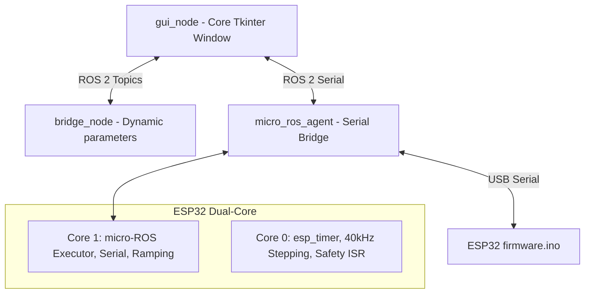

# SCARA Robot Project & Launch Guide

This guide describes how to configure, launch, and use the SCARA robot control workspace. It provides a detailed, section-by-section explanation of the codebase, explains the files, and documents the recent performance restoration updates.

---

## 1. Project Launch & Operation Guide

To run the SCARA robot control GUI and interface it with the ESP32 hardware:

### Step 1: Upload the Firmware
1. Connect the ESP32 board to your computer via USB.
2. Grant read/write permissions to the serial interface:
   ```bash
   sudo chmod a+rw /dev/ttyUSB0
   ```
3. Open the Arduino IDE (ensure the ESP32 board definition v3.x is installed).
4. Open the firmware sketch located at [firmware.ino](file:///home/amir/Desktop/Project/Scara-v2.1.0.0/SCARA_WorkSpace/src/firmware/firmware/firmware.ino) and upload it to the ESP32.

### Step 2: Source the ROS 2 Workspace & Start the Nodes
Open three separate terminal windows to launch the system:

#### Terminal 1: Launch micro-ROS Serial Agent
Spawns the agent that translates serial packets from the ESP32 into ROS 2 topics:
```bash
cd ~/Desktop/Project/Scara-v2.1.0.0/SCARA_WorkSpace
./launch_agent.sh
```

#### Terminal 2: Launch Parameter Bridge Node
Exposes step speed and acceleration limits as ROS 2 parameters:
```bash
cd ~/Desktop/Project/Scara-v2.1.0.0/SCARA_WorkSpace
./launch_bridge.sh
```

#### Terminal 3: Launch Tkinter Dashboard GUI
Opens the dashboard interface:
```bash
cd ~/Desktop/Project/Scara-v2.1.0.0/SCARA_WorkSpace
./launch_gui.sh
```

---

## 2. Project Architecture Overview

The system uses a master-slave communication layout bridged by ROS 2:



- **[gui_node.py](file:///home/amir/Desktop/Project/Scara-v2.1.0.0/SCARA_WorkSpace/src/scara_cfg_bridge/scara_cfg_bridge/gui_node.py)**: The user interface dashboard. Captures user mouse/keyboard commands, runs Cartesian Inverse Kinematics (IK), and publishes command coordinates or streams velocities.
- **[bridge_node.py](file:///home/amir/Desktop/Project/Scara-v2.1.0.0/SCARA_WorkSpace/src/scara_cfg_bridge/scara_cfg_bridge/bridge_node.py)**: Synchronizes stepper motor speeds and accelerations as ROS 2 parameters and distributes heartbeat config updates.
- **[firmware.ino](file:///home/amir/Desktop/Project/Scara-v2.1.0.0/SCARA_WorkSpace/src/firmware/firmware/firmware.ino)**: The real-time controller running on the ESP32. It parses commands, handles homing, runs step logic, and publishes actual joint positions.

---

## 3. Codebase Analysis (Section-by-Section)

### A. ESP32 Firmware: [firmware.ino](file:///home/amir/Desktop/Project/Scara-v2.1.0.0/SCARA_WorkSpace/src/firmware/firmware/firmware.ino)

#### 1. Libraries and Include Directives (Lines 10-21)
- `#include "esp_timer.h"`: Pulls in the high-resolution ESP-IDF timer API to run stepping loops on Core 0.
- `#include <micro_ros_arduino.h>`: The Arduino micro-ROS wrapper library. Must be declared first.
- `#include <AccelStepper.h>`: Handles acceleration calculations and step timing for X, Y, and Z.
- `#include <ESP32Servo.h>`: Provides hardware-based PWM control for custom gripper/wrist servos.
- Messages (`geometry_msgs/msg/Point.h`, `Twist.h`, `std_msgs/msg/String.h`): Core ROS 2 data structures.

#### 2. Globals and Pin Configurations (Lines 24-95)
- Defines stepper step/dir pins (`STEP_X_PIN`, etc.), limit switches (`LIMIT_X_PIN`), and servo outputs.
- Calibration ratios: e.g., `STEPS_PER_DEGREE_X = 47.058f`.
- Declares the `esp_timer_handle_t stepTimer` and a volatile variable `step_interval_us` to dynamically adjust speed generation interrupt rates.

#### 3. High-Frequency Stepper Callback: `onStepTimer` (Lines 148-210)
- Executes periodically on **Core 0** (configured up to 40 kHz / 25 µs).
- **Limit Switch Safety Check**: Instantly verifies if any limit switch is triggered (`LOW`). If triggered, checks if the commanded direction is moving *into* the switch. If so, sets velocity to `0` and halts stepper movement; if moving *away*, it allows execution to recover.
- **Stepper Execution**: Checks the `velocity_mode` flag. If `true`, runs `runSpeed()` (constant velocity mode); if `false`, runs `run()` (position mode).

#### 4. Playout Queue: `enqueue_velocity` and `dequeue_velocity` (Lines 103-130)
- Implements a circular buffer queue of size 8.
- Absorbs incoming packet jitter during high-frequency velocity jogging so motor movements remain smooth.

#### 5. Command Callbacks (Lines 461-647)
- `callback_target_position()`: Subscribed to `/scara/target_position`. Takes a target joint coordinate and sets the stepper targets using `moveTo()`.
- `callback_cmd_vel()`: Subscribed to `/scara/cmd_vel`. Receives target linear velocity values and puts them in the playout queue.
- `callback_config()`: Subscribed to `/scara/config`. Receives live config parameters, updates maximum motor speeds/accelerations, calculates the maximum needed ISR frequency, and calls `esp_timer_start_periodic` to update the step timer period.

#### 6. Setup and Main Loop (Lines 676-899)
- `setup()`: Initializes serial communication, motor states, servo configurations, and configures the `esp_timer` periodic callback.
- `loop()`: Runs on **Core 1**. Processes micro-ROS subscriptions (`rclc_executor_spin_some`), runs the velocity acceleration ramping algorithm (~100 Hz), and publishes position feedback back to the GUI every 60ms.

---

### B. Tkinter Dashboard: [gui_node.py](file:///home/amir/Desktop/Project/Scara-v2.1.0.0/SCARA_WorkSpace/src/scara_cfg_bridge/scara_cfg_bridge/gui_node.py)

#### 1. ROS 2 Communication: `ScaraRosNode` (Lines 24-115)
- Inherits from `rclpy.node.Node`.
- Establishes publishers to direct motor targets, velocity jogging, configuration parameters, and homing commands.
- Subscribes to `/scara/robot_feedback` and parses coordinates and statuses to feed the dashboard.

#### 2. GUI Constructor: `ScaraApp` (Lines 116-150)
- Configures the dark theme, styles, grid structure, starts the high-frequency streaming thread, and calls event bindings.

#### 3. Keyboard Binding and Linux Repeat Filter (Lines 530-565)
- Binds key press and release events.
- **X11 Repeat Filter**: When a key is released, it schedules a callback 20ms in the future. If a key press repeat event occurs before that timer completes, it cancels the release, avoiding oscillating on/off jitter.
- **Focus Safety Check**: Checks `focus_get()`. If the user is currently editing an input text field, manual jogging is temporarily bypassed to prevent accidental movements.

#### 4. Inverse Kinematics (IK) Solver (Lines 673-718)
- Performs inverse kinematics calculations to translate desired $(X, Y, Z)$ Cartesian coordinates into joint angles $(\theta_1, \theta_2, Z_{mm})$ based on link lengths $L_1$ and $L_2$:
  $$\cos(\theta_2) = \frac{x^2 + y^2 - L_1^2 - L_2^2}{2 L_1 L_2}$$
- Converts results to degrees and publishes them as a joint target command.

---

## 4. Summary of Recent Changes & Fixes

1. **Dual-Core Isolation via `esp_timer`**:
   The 40 kHz motor step-generation loop was moved out of standard Arduino interrupts to `esp_timer` task callbacks. This binds the step generation loop to **Core 0**, leaving **Core 1** fully dedicated to processing serial micro-ROS messages.
2. **Limit Switch Non-Lockout Check**:
   Refactored the safety checks in `onStepTimer` to evaluate the movement direction vector relative to the limit switch state. This prevents the robot from freezing at the zero reference position after homing.
3. **X11 Keyboard Jog Debounce**:
   Implemented key-release timers in Python to cancel false key-release events triggered by Linux X11 auto-repeat.
4. **Input Focus Lock**:
   Added checks to prevent keyboard jog inputs from triggering while typing target coordinates.
